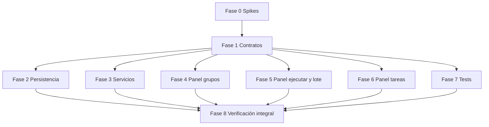

# Plan: Grupos de servidores, ejecución sobre grupos y panel de tareas programadas
**Estado:** Implementado y verificado en automático (fases 0–7 ✅, fase 8 parcial). Pendiente: uso real R1–R6 en navegador con el dueño.
**Última actualización:** 2026-11-25
**Progreso:** Fases 0/9 · Tareas 0/42 · Recorridos aceptados 0/6

## 0. Cómo retomar (resumen para el ejecutor)
- Fase actual: 0 — Spikes de integración
- Siguiente tarea: 0.1
- Bloqueos activos: ninguno
- Ola actual: 0 — spikes S1, S2 y S3 a la vez
- Ejecución en paralelo:
  - Lanza en **un solo mensaje** todos los subagentes de una misma ola; no los lances uno por uno esperando a cada uno.
  - Cada subagente recibe únicamente su fase/carril: su "Contexto para el subagente", sus contratos, sus archivos exclusivos y su verificación.
  - Los subagentes **no hacen commits** ni tocan archivos fuera de los que poseen (ver sección 6). Un desvío se reporta al orquestador, que decide.
  - El orquestador recoge los resultados, ejecuta el punto de unión, corre la verificación de la ola, marca las tareas, llena las Notas de traspaso y solo entonces lanza la ola siguiente.
  - Si un subagente se bloquea, las demás unidades de la ola continúan; el bloqueo se registra y solo detiene lo que depende de él.
  - El orquestador no implementa lo que puede delegar: lanza olas, integra, verifica y registra. Implementa él mismo solo los puntos de unión.
  - Cuadro de olas en la sección 9.
- Lee primero: secciones 2, 4, 5, 6 y 7 (y 1.1 para los recorridos) antes de tocar código. Lee también `CLAUDE.md` y **`docs/CODING_STYLE.md` (normativo y obligatorio: léelo completo antes de escribir código; todo código nuevo debe cumplirlo)**. Cada subagente debe recibir esta instrucción en su prompt.

## 1. Contexto y objetivo
Baion orquesta servidores. Hoy un script solo se lanza sobre **un** servidor (`POST api/executions` recibe un único `ServerId`). Las entidades `ServerGroup` y `ServerGroupMember` existen y las usa el planificador, pero no tienen API ni panel: los grupos solo se crean directamente en base de datos (en los tests). Además, las tareas programadas (`api/scheduled-tasks`) existen en el orquestador pero **no tienen ninguna pantalla** en el panel.

Resultado esperado:
1. El administrador crea, edita y elimina **grupos de servidores** desde el panel (`/grupos`), con tantos servidores como quiera.
2. En la vista de ejecutar un script, el selector de destino lista **servidores y grupos**. Al lanzar sobre un grupo, el script se ejecuta solo en los miembros **compatibles con el script** (por plataforma: un script solo-Linux no va a los Windows) y el resto se omite con motivo visible.
3. Cada lanzamiento sobre un grupo queda registrado como un **lote** (`ExecutionBatch`) que agrupa sus ejecuciones y se puede abrir en el panel.
4. Hay un **panel de tareas programadas** (`/tareas`): listar, crear (sobre servidor o grupo), pausar/reanudar y "ejecutar ahora".
5. Las tareas programadas sobre grupo aplican la misma regla de compatibilidad que el lanzamiento manual.

### 1.1 Recorridos de usuario
| ID | Usuario | Recorrido (datos reales) | Resultado observable esperado |
|----|---------|--------------------------|-------------------------------|
| R1 | Administrador | Entra con `admin@baion.local`, abre `/grupos`, pulsa "Nuevo grupo", escribe `web-prod`, marca 5 servidores (3 Linux, 2 Windows) en el selector y guarda. | Vuelve a `/grupos` y ve `web-prod · 5 servidores` (3 Linux, 2 Windows). |
| R2 | Administrador | Abre `web-prod` en edición, quita un servidor, añade dos más y guarda. Luego intenta eliminar el grupo `web-prod`, que tiene una tarea programada, y después elimina otro grupo `pruebas` sin tareas. | Los miembros cambian. Eliminar `web-prod` muestra el error "tiene tareas programadas". `pruebas` desaparece y sus servidores siguen existiendo. |
| R3 | Administrador | Abre el script `reiniciar-nginx` (Bash, solo Linux), pulsa "Ejecutar", en el selector ve las secciones "Servidores" y "Grupos", elige `web-prod` y ve el aviso "Se ejecutará en 3 de 5 servidores (2 no compatibles con Bash)". Lanza con un servidor Linux apagado. | Aparece un resumen: 2 lanzadas, 1 fallida por agente desconectado, 2 omitidas por incompatibles, con enlace "Ver lote". En el lote ve las ejecuciones creadas con su estado. |
| R4 | Administrador | Abre `/tareas`, pulsa "Nueva tarea", crea `backup-nocturno` con el script `backup.sh`, cron `0 3 * * *`, zona `America/Bogota`, destino el grupo `web-prod`. | La tarea aparece en la lista con su próxima ejecución calculada y destino `web-prod`. |
| R5 | Administrador | En `/tareas` pausa `backup-nocturno`, la reanuda y pulsa "Ejecutar ahora". | Pausada: estado "Pausada" y sin próxima ejecución relevante. Reanudada: vuelve a tener próxima ejecución. "Ejecutar ahora" muestra "3 destinos: 2 lanzadas, 0 fallidas, 1 omitida" (cifras según el grupo). |
| R6 | Usuario autenticado sin rol Admin | Entra con una sesión sin rol Admin, abre `/grupos` y ve la lista, lanza un script sobre `web-prod`, e intenta crear un grupo. | Ve los grupos y puede ejecutar sobre ellos. Al crear/editar/eliminar un grupo el panel muestra el mensaje de 403 de la API (sin ocultar botones). |

## 2. Estado inicial del proyecto
- **Rama de partida / commit:** `main`, commit `085e3ef` ("reestructura de código"), árbol limpio.
- **Rama de trabajo:** la actual; el ejecutor no crea commits. El usuario decide si abre una rama.
- **Estructura relevante** (`ORCH` = `src/Orchestrator`, cada proyecto con prefijo `LIN.Cloud.Enterprise.Baion.Orchestrator.`):
  - `ORCH/*Models` — entidades (`Entities/…`), DTOs (`Dtos/…`), `Results/`.
  - `ORCH/*Persistence` — `Configurations/`, `Repositories/<Area>/` con `Implementations/`, `Migrations/`, `Extensions/ServiceCollectionExtensions.cs`.
  - `ORCH/*Services` — `Services/Scripts/` con `Implementations/`.
  - `ORCH/*Presentacion` — `Controllers/`, `Extensions/ServiceCollectionExtensions.cs`.
  - `src/LIN.Cloud.Enterprise.Baion.Contracts` — protocolo compartido, **no se toca**.
  - `cliente/LIN.Cloud.Enterprise.Baion.Cliente.Web` (`CW`) — panel Blazor WASM.
  - `tests/…Orchestrator.Agents.Tests` (integración con `WebApplicationFactory` y `FakeAgent`), `tests/…Orchestrator.Persistence.Tests`.
- **Archivos clave existentes:**
  - `ORCH/*Models/Entities/Servers/ServerGroup.cs`, `ServerGroupMember.cs` — entidades de grupo (Name ≤200 único por tenant, Description ≤1000, miembros explícitos, único `(ServerGroupId, ServerId)`, cascada al borrar grupo o servidor).
  - `ORCH/*Persistence/Configurations/ServerGroupConfiguration.cs`, `ServerGroupMemberConfiguration.cs`.
  - `ORCH/*Services/Services/Scripts/Implementations/ScheduledTaskService.cs` — `FireAsync` despacha servidor a servidor; `ResolveTargetsAsync` usa `IScheduledTaskRepository.GetGroupServerIdsAsync(tenantId, groupId)`.
  - `ORCH/*Services/Services/Scripts/Implementations/ScriptDispatchService.cs` — `DispatchAsync`, `DispatchScheduledAsync`, `DispatchChainStepAsync`, todos convergen en `SendAsync` (rechaza `Server.Status == Disabled` con `server.disabled`, compara `ScriptRuntimeCompatibility` con `execution.runtime_incompatible`, crea `ScriptExecution` en `Pending`, envía por `IAgentCommandBus`; si el agente no está conectado falla y borra la fila con `agent.not_connected`).
  - `src/LIN.Cloud.Enterprise.Baion.Contracts/Services/ScriptRuntimeCompatibility.cs` — `IsSupported(ScriptRuntime, ServerPlatform)`. Bash/Sh: Linux. PowerShellCore y PythonCross: Linux y Windows. WindowsPowerShell: Windows.
  - `ORCH/*Presentacion/Controllers/ScheduledTasksController.cs` (hoy: POST, GET `{id}`, POST `{id}/runs`), `ExecutionsController.cs`, `ServersController.cs` (patrón `disable`/`enable` y `[Authorize(Roles = AuthorizationRoles.Admin)]` por método).
  - `ORCH/*Persistence/Repositories/Servers/IServerQueries.cs` + `Implementations/ServerQueries.cs` — patrón de consulta que proyecta a DTO (`AsNoTracking`, sin `Include`).
  - `CW/Components/Shared/DispatchScriptForm.razor` — formulario inline de ejecución (un `InputSelect` de servidores online y compatibles; `LanzarAsync` navega a `/ejecuciones/{id}`).
  - `CW/Components/Layout/TopBar.razor` — array estático `Enlaces` (pills).
  - `CW/Services/IBaionApiClient.cs` y `Implementations/BaionApiClient.cs` — cliente HTTP, helpers `GetAsync`, `SendAsync`, `QueryString`.
  - `CW/Dtos/<Area>/*.cs` — DTOs del panel duplicados a mano (records). **Corrección a CLAUDE.md:** no existe `Models/ApiModels.cs`; son archivos sueltos en `Dtos/`.
  - `CW/Constants/LucideIcons.cs` — diccionario nombre → paths SVG. `CW/Utilities/ScriptRuntimes.cs` — `IsSupported`, `PlatformLabel`.
  - Páginas de referencia: `Scripts.razor`, `NewScript.razor`, `EditScript.razor`, `ScriptForm.razor` (CRUD), `Servers.razor` + `ServerTable.razor` (tabla con acciones), `ServerServiceDetail.razor` (uso de `ConfirmDialog`).
  - Tests de referencia: `Agents.Tests/Scheduling/ScheduledTaskTests.cs` (helpers `CrearGrupoAsync`, `CrearScriptAsync`, `CrearTareaAsync`…), `Agents.Tests/Scripts/ScriptDispatchTests.cs` (plataforma incompatible, agente desconectado), `Persistence.Tests/Isolation/AislamientoMultiTenantTests.cs`.
- **Comandos:**
  - Compilar: `dotnet build LIN.Cloud.Enterprise.Baion.Orchestrator.sln`, `dotnet build LIN.Cloud.Enterprise.Baion.Agent.sln`, `dotnet build cliente/LIN.Cloud.Enterprise.Baion.Cliente.sln` (los tres con 0 warnings; `TreatWarningsAsErrors` activo).
  - Ejecutar: `dotnet run --project src/Orchestrator/LIN.Cloud.Enterprise.Baion.Orchestrator.Presentacion` (5199) y `dotnet run --project cliente/LIN.Cloud.Enterprise.Baion.Cliente.Web` (5100).
  - Tests: `dotnet test tests/<proyecto>/<proyecto>.csproj [--filter "FullyQualifiedName~Clase"]`.
  - Migraciones: `dotnet ef migrations add <Nombre> --project src/Orchestrator/LIN.Cloud.Enterprise.Baion.Orchestrator.Persistence --startup-project src/Orchestrator/LIN.Cloud.Enterprise.Baion.Orchestrator.Persistence --output-dir Migrations`; aplicar con `dotnet ef database update` con los mismos `--project/--startup-project`.
- **Variables de entorno / configuración:** `BAION_DESIGN_CONNECTION` (cadena para `dotnet ef`), `BAION_TEST_CONNECTION` (SQL Server para tests, por defecto LocalDB). Para el panel en local: orquestador `Cors:AllowedOrigins` ya incluye `http://localhost:5100`.

## 3. Alcance
- **Incluye:**
  - API CRUD de grupos (`api/server-groups`), con escritura solo para Admin.
  - Lanzamiento de un script sobre un grupo con filtro de compatibilidad por plataforma y entidad `ExecutionBatch` (lote) con consulta de detalle.
  - Endpoints nuevos de tareas programadas: listar, pausar y reanudar.
  - Compatibilidad por plataforma también en las tareas programadas con script sobre grupo.
  - Panel: páginas de grupos (lista, alta, edición, eliminación), selector de destino con grupos en la vista de ejecutar, vista de lote, panel de tareas programadas (lista, alta con script, pausar/reanudar, ejecutar ahora), iconos y enlaces de navegación.
  - Tests de integración en el orquestador y de aislamiento multi-tenant.
- **No incluye:**
  - Detección real de intérpretes instalados en el servidor (el agente no la reporta; "compatible" = plataforma).
  - Ejecutar **cadenas** sobre un grupo desde la vista de ejecutar, ni crear tareas con cadena desde el panel (no existe endpoint de listado de cadenas). Las tareas con cadena creadas por API sí se listan.
  - Editar o eliminar tareas programadas (solo pausar/reanudar; ver Pendientes).
  - Listado general de lotes (solo detalle de un lote).
  - Persistir el resultado por servidor de los omitidos/fallidos (solo contadores en el lote; el detalle por servidor viaja en la respuesta del lanzamiento).
  - Ocultar botones por rol en el panel; tests de componentes Blazor (no existe proyecto de tests del cliente).
  - Cambios al agente, al protocolo o a `Contracts`.

## 4. Decisiones, supuestos y alternativas descartadas
### Decisiones
| # | Decisión | Motivo | Origen |
|---|----------|--------|--------|
| D1 | Grupos como sección propia `/grupos`: crear, editar, eliminar y gestionar miembros. Un servidor puede estar en varios grupos; un grupo puede estar vacío. | Respuesta P1 | PO |
| D2 | "Compatible" = `ScriptRuntimeCompatibility.IsSupported(script.Runtime, server.Platform)`. Al lanzar sobre un grupo, los servidores con plataforma no soportada por el script se omiten; Windows y Linux comparten los intérpretes multiplataforma (PowerShellCore, PythonCross). | Respuesta P2 | PO |
| D3 | Servidores `Disabled` del grupo se omiten. Servidores sin agente conectado fallan al instante (como una ejecución suelta, `agent.not_connected`, sin crear fila). No se usa `OfflineGraceSeconds` en el lanzamiento manual. | Respuesta P3 | PO |
| D4 | Si ningún servidor es despachable (compatible y no deshabilitado) se rechaza con `batch.no_compatible_servers` y no se crea nada. | Respuesta P4 | PO |
| D5 | Nueva entidad `ExecutionBatch` (lote) con contadores; `ScriptExecution.BatchId` opcional. | Respuesta P5 | PO |
| D6 | No se puede eliminar un grupo referenciado por **cualquier** tarea programada (activa o pausada): 409 `group.in_use_by_scheduled_tasks`. | Respuesta P6 | PO |
| D7 | Selector de destino único en `DispatchScriptForm` con dos `<optgroup>`: "Servidores" y "Grupos"; los grupos muestran cuántos miembros son compatibles; un grupo sin compatibles aparece deshabilitado. | Respuesta P7 | PO |
| D8 | Solo scripts sueltos sobre grupos; las cadenas quedan fuera. | Respuesta P8 | PO |
| D9 | Cualquier usuario autenticado lista grupos y ejecuta sobre ellos; crear/editar/eliminar grupo es solo `Admin` (`[Authorize(Roles = AuthorizationRoles.Admin)]` por método). Límite de 500 miembros al **lanzar** sobre un grupo (`batch.group_too_large`); sin límite de membresía. | Respuesta P9 | PO |
| D10 | Solo tests de integración en el orquestador; el cliente no tiene proyecto de tests y no se crea uno. | Respuesta P10 | PO |
| D11 | El panel de tareas programadas cubre listar, crear (con script, nunca con cadena), pausar/reanudar y ejecutar ahora. Para ello se añaden endpoints `GET api/scheduled-tasks`, `POST …/{id}/enable` y `POST …/{id}/disable`. Los endpoints de tareas siguen con `[Authorize]` de clase (cualquier usuario autenticado), igual que hoy. | Petición del usuario ("tareas programadas… no está en el front") + valores por defecto del planificador. **Se invalida si** el usuario quiere crear tareas con cadena desde el panel (haría falta `GET api/chains`) o editar/eliminar tareas. | Análisis + PO |
| D12 | Las tareas programadas con **script** sobre grupo aplican el mismo filtro de compatibilidad/deshabilitados que el lanzamiento manual. Las tareas con **cadena** sobre grupo mantienen el comportamiento actual (el servidor incompatible cuenta como fallido porque `ScriptChainService.StartAsync` ya lo rechaza). `ScheduledTaskTriggered` gana el campo `Skipped`. | Consistencia con D2 sin tocar cadenas | Análisis |
| D13 | El cálculo del aviso "X de N compatibles" en el panel se hace en el cliente con `ScriptRuntimes.IsSupported` sobre el detalle del grupo; no hay endpoint de previsualización. | Evita un endpoint extra; el servidor revalida siempre | Análisis |
| D14 | Los DTOs del panel se duplican a mano en `CW/Dtos/<Area>/` (no se referencia el ensamblado del servidor). Los enums viajan como cadenas camelCase (`JsonStringEnumConverter` ya configurado en el servidor). | CLAUDE.md | Convención |
| D15 | El lanzamiento sobre grupo despacha **en serie** (un `DbContext` por scope no es seguro en paralelo), reusando `ScriptDispatchService`. | Simplicidad y seguridad; rendimiento aceptado hasta 500 miembros | Análisis |

### Supuestos
| # | Supuesto | Qué pasa si es falso |
|---|----------|----------------------|
| S1 | El mapeo `ErrorKind → HTTP` en `ResultExtensions` es Validation→400, NotFound→404, Conflict→409. (Spike 0.1) | Ajustar los códigos de la tabla 7.4 a los reales sin cambiar `ErrorKind`. |
| S2 | En el planificador, el scope de cada disparo ya tiene `ITenantContext` resuelto (los repositorios filtrados funcionan en `FireAsync`). (Spike 0.1) | Usar la sobrecarga con `tenantId` explícito de `GetMemberTargetsAsync` (ya prevista en 7.5) también para los servicios que dependen del filtro. |
| S3 | `CronSchedule` acepta el formato y los identificadores de zona horaria que el panel enviará; se documenta en el formulario el formato real (5 o 6 campos; IANA o Windows). (Spike 0.1) | Ajustar la ayuda/validación del formulario y el valor por defecto de zona. |
| S4 | Las FKs nuevas (`execution_batches.server_group_id` con `SET NULL`, `script_executions.batch_id` con `NO ACTION`) no producen "múltiples rutas de cascada" en SQL Server. (Spike 0.2) | Poner `NO ACTION` en `server_group_id` y que el servicio ponga a null al eliminar el grupo. |
| S5 | `InputSelect` de Blazor admite hijos `<optgroup>` con `@bind-Value` de tipo `string`. (Spike 0.3) | Fallback: una sola lista con prefijos "Servidor ·" / "Grupo ·" sin `optgroup`. |
| S6 | `ScriptChain` tiene un `Name` y `ScheduledTask` puede proyectar el nombre de script/cadena/servidor/grupo en una consulta sin `Include`. (Spike 0.1) | Mostrar el identificador corto en lugar del nombre en la lista de tareas. |

### Alternativas descartadas
| # | Alternativa | Por qué se descartó |
|---|-------------|---------------------|
| A1 | Lanzar N ejecuciones sueltas sin lote | El usuario aprobó el lote (P5): permite abrir "la ejecución del grupo". |
| A2 | Inventario de intérpretes por servidor reportado por el agente | Cambia el protocolo y el agente; fuera de alcance (P2). |
| A3 | Endpoint de previsualización de compatibilidad | Cálculo trivial en el cliente (D13); el servidor revalida. |
| A4 | Persistir un registro por servidor omitido/fallido | Complejidad extra; basta con contadores + respuesta del lanzamiento. |
| A5 | Eliminar tareas programadas en este plan | La FK `script_executions → scheduled_tasks` es `NO ACTION`; borrar exigiría cambiar esa FK. Se ofrece pausar. |
| A6 | Referenciar el ensamblado de DTOs del servidor desde el panel | Prohibido por CLAUDE.md. |
| A7 | Despacho en paralelo dentro de una petición | `DbContext` no es seguro entre hilos (D15). |

## 5. Convenciones del proyecto
- **Idioma:** identificadores de tipos y miembros en inglés; comentarios, XML docs, logs, errores y toda la UI en español. Locales dentro de un método pueden ir en español (sigue el archivo que toques).
- **Estilo:** `docs/CODING_STYLE.md` es **normativo y obligatorio** (léelo completo antes de escribir código; ante duda, manda esa guía sobre lo que veas en otros archivos); `.editorconfig` lo aplica (file-scoped namespaces, modificadores explícitos, `_camelCase`, sufijo `Async`). `ImplicitUsings` desactivado: declara todos los `using`. `TreatWarningsAsErrors`.
- **Capas:** interfaces `public` en la raíz de cada proyecto, implementaciones `internal` en `Implementations/`, registro en el `AddXxx` de cada capa.
- **Errores esperados:** `Result<T>` / `Error` (`Models/Results/`); nunca excepciones. `Error.Validation`, `Error.NotFound`, `Error.Conflict`.
- **Multitenancy:** las entidades nuevas heredan de `TenantEntity` (filtro global + sello de `tenant_id`). Consultas de panel proyectan a DTO con `AsNoTracking`, sin `Include`.
- **Controladores:** constructor primario con la interfaz del servicio, rutas `{id:guid}`, `.ToActionResult()`.
- **Panel:** sistema de diseño "Quiet Data" (`Styles/app.css` única fuente). Ni hex ni colores de la paleta de Tailwind; solo escala tipográfica `display · metric-xl · metric-lg · heading · title · body · value · label`. Acción primaria negra, tarjetas con hairline y sin sombra, acento como máximo en tres sitios por vista. Iconos solo Lucide embebidos (`Icon` + `LucideIcons`), trazo 1.5. Botones con `MouseState` + `MouseEvents`.
- **Archivos de referencia a imitar:**
  - Entidad+config+repo+servicio+controlador: `ScheduledTask` (`ScheduledTask.cs`, `ScheduledTaskConfiguration.cs`, `ScheduledTaskRepository.cs`, `ScheduledTaskService.cs`, `ScheduledTasksController.cs`).
  - Consultas a DTO: `ServerQueries.cs`, `ScriptQueries.cs`.
  - Página CRUD: `Scripts.razor`, `NewScript.razor`, `EditScript.razor`, `ScriptForm.razor` (el form expone `OnGuardar`, `Guardando`, `ErrorGeneral`, `ErrorCodigo`; la página llama a la API y navega).
  - Tabla con acciones y confirmación: `ServerTable.razor`, `ServerServiceDetail.razor` (`ConfirmDialog`).
  - Tests: `ScheduledTaskTests.cs`, `ScriptDispatchTests.cs`, `AislamientoMultiTenantTests.cs`. Nombres de test `Sujeto_Condicion_Resultado` en español.
- **Commits:** el ejecutor NO hace commits. Dejar los cambios sin commitear.

## 6. Guardrails (lo que el ejecutor NO debe hacer)
- NUNCA escribir código sin haber leído antes `docs/CODING_STYLE.md`; un código que lo incumpla se considera no terminado, aunque compile.
- NUNCA hacer commits (ni `git commit`, ni amend, ni push). Los cambios se dejan en el árbol de trabajo para que el usuario los revise y commitee.
- No modificar: `src/LIN.Cloud.Enterprise.Baion.Contracts`, el proyecto del agente (`src/Agent/**`), el protocolo de mensajes, `xunit.runner.json` de `Agents.Tests` (serializa las colecciones), ni `Styles/app.css` salvo que una clase del sistema de diseño falte (en ese caso, registrarlo en Pendientes y preguntar).
- No modificar migraciones existentes; crear una nueva (`AddServerGroupBatches`). No tocar `ServerGroup`/`ServerGroupMember` ni sus configuraciones salvo lo explícito en 7.2.
- No agregar dependencias NuGet/npm. Si hiciera falta, detenerse y preguntar (Protocolo de desvíos).
- No cambiar contratos fuera de lo especificado en la sección 7. No reintroducir las alternativas descartadas.
- No escribir en base de datos desde el hilo del socket; no tocar `AgentConnectionHandler` ni las colas de ingesta.
- No quitar el `ITenantContext`/filtros globales ni usar `IgnoreQueryFilters()` salvo en `GetMemberTargetsAsync(tenantId, groupId)` (comentado) y donde ya se use.
- No usar colores hex ni clases de color por defecto de Tailwind ni sombras en tarjetas; no usar iconos que no sean Lucide embebidos.
- No borrar código existente sin confirmación (los cambios a `ScheduledTaskService` son aditivos salvo lo indicado en 7.2).
- Comentarios `//` prohibidos en JSON de `wwwroot` del panel.
- Un `PackageReference` con `Version=` inline falla: no se toca ningún `.csproj` de paquetes.

## 7. Contratos
### 7.1 Entidades nuevas
#### ExecutionBatch (`ORCH/*Models/Entities/Scripts/ExecutionBatch.cs`)
- **Propósito:** registrar un lanzamiento de un script sobre un grupo y agrupar sus ejecuciones.
- **Tabla:** `execution_batches` (`DbSet<ExecutionBatch> ExecutionBatches`; nombres snake_case por la convención global). Hereda de `TenantEntity` (`Id` v7, `TenantId`, `CreatedAt`, `UpdatedAt`).

| Propiedad | Tipo | Nullable | Default | Restricciones | Descripción |
|-----------|------|----------|---------|---------------|-------------|
| ServerGroupId | Guid | sí | null | FK → `server_groups`, `ON DELETE SET NULL` | Grupo de origen (queda null si el grupo se elimina) |
| ServerGroupName | string | no | "" | máx. 200 | Nombre del grupo en el momento del lanzamiento |
| ScriptId | Guid | no | — | FK → `scripts`, `NO ACTION` | Script lanzado |
| ScriptName | string | no | "" | máx. 200 | Nombre del script en el momento del lanzamiento |
| Mode | ExecutionMode | no | — | enum a int (como el resto) | Attached/Detached |
| RequestedBy | string | sí | null | máx. 320 | Email del usuario (`User.Identity.Name`) |
| TotalMembers | int | no | 0 | ≥ 0 | Miembros del grupo al lanzar |
| DispatchedCount | int | no | 0 | ≥ 0 | Ejecuciones aceptadas y enviadas |
| SkippedIncompatibleCount | int | no | 0 | ≥ 0 | Omitidos por plataforma no soportada |
| SkippedDisabledCount | int | no | 0 | ≥ 0 | Omitidos por servidor deshabilitado |
| FailedCount | int | no | 0 | ≥ 0 | Fallidos (agente desconectado, error al enviar) |

- **Relaciones:** N:1 con `ServerGroup` (opcional, set null), N:1 con `Script` (no action), 1:N con `ScriptExecution` vía `ScriptExecution.BatchId` (no action).
- **Índices:** `(TenantId, CreatedAt)`; el de FK a `scripts` y `server_groups` los genera EF.
- **Invariante:** `DispatchedCount + SkippedIncompatibleCount + SkippedDisabledCount + FailedCount == TotalMembers` al cerrar el lanzamiento.
- **Multitenancy:** `TenantEntity` (filtro de lectura y sello de escritura automáticos).

### 7.2 Entidades existentes modificadas
#### ScriptExecution (`ORCH/*Models/Entities/Scripts/ScriptExecution.cs`)
- **Estado actual:** FK `ServerId`, `ScriptId`, opcionales `ScriptChainStepId`, `ScheduledTaskId`, `ChainRunId`, `DispatchDeadline`; índices listados en el análisis (incluye único filtrado `(ChainRunId, ScriptChainStepId)`).
- **Cambios:**

| Cambio | Propiedad | Antes | Después | Motivo |
|--------|-----------|-------|---------|--------|
| agregar | `BatchId` (`Guid?`) y navegación `Batch` | no existía | FK a `execution_batches`, `NO ACTION`, índice filtrado `[batch_id] IS NOT NULL` | Agrupar ejecuciones de un lote |

- **Migración:** `AddServerGroupBatches` — crea `execution_batches`, añade columna `batch_id` + FK + índice. Sin migración de datos (columna nullable).
- **Compatibilidad:** las ejecuciones previas quedan con `batch_id` NULL. Consumidores existentes no se ven afectados.

#### ScheduledTaskTriggered (`ORCH/*Models/Dtos/Scheduling/ScheduledTaskTriggered.cs`)
- **Estado actual:** `(Guid TaskId, int Targets, int Delivered, int Failed)`.
- **Cambios:**

| Cambio | Propiedad | Antes | Después | Motivo |
|--------|-----------|-------|---------|--------|
| agregar | `Skipped` | — | `int Skipped` (4.º posición: `TaskId, Targets, Delivered, Failed, Skipped`) | Omitidos por incompatibilidad o deshabilitado (D12) |

- **Invariante:** `Delivered + Failed + Skipped == Targets`.
- **Compatibilidad:** actualizar las construcciones existentes (`ScheduledTaskService.FireAsync`, tests de `ScheduledTaskTests`) añadiendo `0` donde corresponda. Los tests existentes (grupo homogéneo) siguen pasando.

#### ScheduledTaskService / IScheduledTaskService (ver 7.5): añade `ListAsync`, `EnableAsync`, `DisableAsync` y filtra por compatibilidad en `ResolveTargetsAsync` para tareas con script sobre grupo.
#### ScriptDispatchService / IScriptDispatchService (ver 7.5): añade `DispatchBatchItemAsync`; `PreparedDispatch` gana `BatchId` que `SendAsync` copia a `ScriptExecution.BatchId`.

### 7.3 DTOs / modelos de entrada y salida
**Backend** (`ORCH/*Models/Dtos/Servers/` y `…/Executions/`, `…/Scheduling/`):
```csharp
// Servers
public record ServerGroupSummary(Guid Id, string Name, string? Description, int MemberCount, int LinuxCount, int WindowsCount, DateTimeOffset CreatedAt);
public record ServerGroupMemberSummary(Guid ServerId, string Name, string Hostname, ServerPlatform Platform, ServerStatus Status);
public record ServerGroupDetail(Guid Id, string Name, string? Description, IReadOnlyList<ServerGroupMemberSummary> Members, DateTimeOffset CreatedAt);
public record GroupMemberTarget(Guid ServerId, string ServerName, ServerPlatform Platform, ServerStatus Status);
// Requests (Servers/Requests/)
public record CreateServerGroupRequest(string Name, string? Description, IReadOnlyList<Guid>? ServerIds);
public record UpdateServerGroupRequest(string Name, string? Description, IReadOnlyList<Guid>? ServerIds); // reemplazo completo de miembros
// Executions
public record DispatchGroupRequest(Guid ScriptId, Guid ServerGroupId, ExecutionMode Mode, int? TimeoutSeconds, string? WorkingDirectory, IReadOnlyDictionary<string, string>? EnvironmentVariables);
public enum BatchTargetOutcome { Dispatched = 1, SkippedIncompatible = 2, SkippedDisabled = 3, Failed = 4 }
public record BatchTargetResult(Guid ServerId, string ServerName, BatchTargetOutcome Outcome, Guid? ExecutionId, string? ErrorCode, string? Message);
public record DispatchGroupResult(Guid BatchId, int Total, int Dispatched, int SkippedIncompatible, int SkippedDisabled, int Failed, IReadOnlyList<BatchTargetResult> Targets);
public record ExecutionBatchDetail(Guid Id, Guid? ServerGroupId, string ServerGroupName, Guid ScriptId, string ScriptName, ExecutionMode Mode, string? RequestedBy, int TotalMembers, int DispatchedCount, int SkippedIncompatibleCount, int SkippedDisabledCount, int FailedCount, DateTimeOffset CreatedAt, IReadOnlyList<ScriptExecutionListItem> Executions);
// Scheduling
public record ScheduledTaskListItem(Guid Id, string Name, string CronExpression, string TimeZoneId, string PayloadKind /* "script" | "chain" */, string PayloadName, string TargetKind /* "server" | "group" */, string TargetName, ExecutionMode Mode, bool IsEnabled, DateTimeOffset? LastRunAt, DateTimeOffset? NextRunAt);
```
Validaciones: `Name` obligatorio (trim, ≤200); `Description` ≤1000; `ServerIds` null = vacío, se deduplica en silencio.
`ScriptExecutionListItem` ya existe; reutilizarlo tal cual.

**Panel** (`CW/Dtos/ServerGroups/`, `…/Executions/`, `…/Scheduling/`): los mismos records con **enums como `string`** (camelCase: `"linux"`, `"windows"`, `"dispatched"`, `"skippedIncompatible"`…), uno por archivo. Nombres idénticos salvo el prefijo del área. Más: `CreateServerGroupRequest`, `UpdateServerGroupRequest`, `DispatchGroupRequest` (`Mode` como string), `CreateScheduledTaskRequest` (para el panel: `Name, CronExpression, TimeZoneId, ScriptId, ServerId, ServerGroupId, Mode, OfflineGraceSeconds`; `ScriptChainId` siempre null) y `ScheduledTaskSummary`/`ScheduledTaskTriggered` (con `Skipped`).

### 7.4 Endpoints / APIs
| Verbo | Ruta | Auth | Request | Response | Errores | Estado |
|-------|------|------|---------|----------|---------|--------|
| GET | `api/server-groups` | `[Authorize]` | — | `ServerGroupSummary[]` | 401 | Nuevo |
| GET | `api/server-groups/{id:guid}` | `[Authorize]` | — | `ServerGroupDetail` | 401; 404 `group.not_found` | Nuevo |
| POST | `api/server-groups` | Admin | `CreateServerGroupRequest` | `ServerGroupDetail` | 400 `group.name_required`/`group.name_too_long`/`group.description_too_long`; 404 `group.server_not_found`; 409 `group.name_taken`; 401; 403 | Nuevo |
| PUT | `api/server-groups/{id:guid}` | Admin | `UpdateServerGroupRequest` | `ServerGroupDetail` | igual que POST + 404 `group.not_found` | Nuevo |
| DELETE | `api/server-groups/{id:guid}` | Admin | — | 204 | 404 `group.not_found`; 409 `group.in_use_by_scheduled_tasks`; 401; 403 | Nuevo |
| POST | `api/executions/batches` | `[Authorize]` | `DispatchGroupRequest` | `DispatchGroupResult` | 400 `execution.timeout_invalid`/`batch.group_empty`/`batch.group_too_large`/`batch.no_compatible_servers`; 404 `script.not_found`/`group.not_found`; 401 | Nuevo (en `ExecutionsController`) |
| GET | `api/executions/batches/{batchId:guid}` | `[Authorize]` | — | `ExecutionBatchDetail` | 404 `batch.not_found`; 401 | Nuevo |
| GET | `api/scheduled-tasks` | `[Authorize]` | — | `ScheduledTaskListItem[]` | 401 | Nuevo |
| POST | `api/scheduled-tasks/{taskId:guid}/disable` | `[Authorize]` | — | `ScheduledTaskSummary` | 404 `task.not_found`; 401 | Nuevo |
| POST | `api/scheduled-tasks/{taskId:guid}/enable` | `[Authorize]` | — | `ScheduledTaskSummary` | 404 `task.not_found`; 400 `task.cron_never_fires`; 401 | Nuevo |
| POST | `api/scheduled-tasks/{taskId:guid}/runs` | `[Authorize]` | — | `ScheduledTaskTriggered` (ahora con `Skipped`) | 404 `task.not_found` | Modificado |

Los códigos HTTP dependen de S1 (verificar en el spike 0.1; no cambiar `ErrorKind`).

### 7.5 Interfaces y firmas
```csharp
// Persistence (public, raíz de Repositories/Servers/)
public interface IServerGroupRepository : IRepository<ServerGroup>
{
    Task<ServerGroup?> GetWithMembersAsync(Guid groupId, CancellationToken ct = default);          // con tracking; filtra por tenant
    Task<bool> NameExistsAsync(string name, Guid? excludeGroupId, CancellationToken ct = default);
    Task<bool> HasScheduledTasksAsync(Guid groupId, CancellationToken ct = default);
    Task<IReadOnlyList<GroupMemberTarget>> GetMemberTargetsAsync(Guid groupId, CancellationToken ct = default);                  // filtra por tenant del scope
    Task<IReadOnlyList<GroupMemberTarget>> GetMemberTargetsAsync(Guid tenantId, Guid groupId, CancellationToken ct = default);  // IgnoreQueryFilters + tenant explícito (scheduler)
    Task<int> CountServersAsync(IReadOnlyCollection<Guid> serverIds, CancellationToken ct = default);                            // cuántos existen en el tenant
}
public interface IServerGroupQueries
{
    Task<IReadOnlyList<ServerGroupSummary>> ListAsync(CancellationToken ct = default);
    Task<ServerGroupDetail?> GetAsync(Guid groupId, CancellationToken ct = default);
}
public interface IExecutionBatchQueries { Task<ExecutionBatchDetail?> GetAsync(Guid batchId, CancellationToken ct = default); }
public interface IScheduledTaskQueries { Task<IReadOnlyList<ScheduledTaskListItem>> ListAsync(CancellationToken ct = default); }

// Services (public, raíz)
public interface IServerGroupService
{
    Task<Result<IReadOnlyList<ServerGroupSummary>>> ListAsync(CancellationToken ct);
    Task<Result<ServerGroupDetail>> GetAsync(Guid groupId, CancellationToken ct);
    Task<Result<ServerGroupDetail>> CreateAsync(CreateServerGroupRequest request, CancellationToken ct);
    Task<Result<ServerGroupDetail>> UpdateAsync(Guid groupId, UpdateServerGroupRequest request, CancellationToken ct);
    // Delete: imitar el retorno de los métodos sin valor de IServerService (disable/enable) o del servicio equivalente existente.
    Task<Result<...>> DeleteAsync(Guid groupId, CancellationToken ct);
}
public interface IGroupTargetResolver
{
    GroupTargetPartition Partition(ScriptRuntime runtime, IReadOnlyList<GroupMemberTarget> members);
}
public record GroupTargetPartition(IReadOnlyList<GroupMemberTarget> Dispatchable, IReadOnlyList<GroupMemberTarget> SkippedIncompatible, IReadOnlyList<GroupMemberTarget> SkippedDisabled);
public interface IGroupDispatchService
{
    Task<Result<DispatchGroupResult>> DispatchAsync(DispatchGroupRequest request, string? requestedBy, CancellationToken ct);
    Task<Result<ExecutionBatchDetail>> GetBatchAsync(Guid batchId, CancellationToken ct);
}
// IScriptDispatchService (modificado): añadir
Task<Result<ScriptExecutionDispatched>> DispatchBatchItemAsync(BatchDispatch request, CancellationToken ct);
public record BatchDispatch(Guid BatchId, Guid ScriptId, Guid ServerId, ExecutionMode Mode, int? TimeoutSeconds, string? WorkingDirectory, IReadOnlyDictionary<string, string>? EnvironmentVariables);
// IScheduledTaskService (modificado): añadir
Task<Result<IReadOnlyList<ScheduledTaskListItem>>> ListAsync(CancellationToken ct);
Task<Result<ScheduledTaskSummary>> EnableAsync(Guid taskId, CancellationToken ct);
Task<Result<ScheduledTaskSummary>> DisableAsync(Guid taskId, CancellationToken ct);
```
Regla de `Partition`: un miembro con `Status == Disabled` va a `SkippedDisabled` **aunque** sea compatible; si no está deshabilitado y `!ScriptRuntimeCompatibility.IsSupported(runtime, platform)` va a `SkippedIncompatible`; el resto a `Dispatchable`. Comprobar primero incompatibilidad (un servidor incompatible y deshabilitado cuenta como incompatible).

**Panel** (`IBaionApiClient` + `BaionApiClient`): `GetServerGroupsAsync`, `GetServerGroupAsync(id)`, `CreateServerGroupAsync`, `UpdateServerGroupAsync`, `DeleteServerGroupAsync`, `DispatchGroupAsync`, `GetExecutionBatchAsync(id)`, `GetScheduledTasksAsync`, `CreateScheduledTaskAsync`, `EnableScheduledTaskAsync(id)`, `DisableScheduledTaskAsync(id)`, `TriggerScheduledTaskAsync(id)`; todos `Task<ApiResult<T>>` con `CancellationToken` y XML doc en español. Rutas de 7.4. `DeleteServerGroupAsync` usa `ApiResult` del tipo ya usado por acciones sin cuerpo (imitar `DisableServerAsync`).

**Páginas/componentes del panel nuevos:** `Components/Pages/ServerGroups.razor` (`/grupos`), `NewServerGroup.razor` (`/grupos/nuevo`), `EditServerGroup.razor` (`/grupos/{Id:guid}/editar`), `ExecutionBatchDetail.razor` (`/ejecuciones/lote/{Id:guid}`), `ScheduledTasks.razor` (`/tareas`), `NewScheduledTask.razor` (`/tareas/nueva`); `Components/Shared/ServerGroupForm.razor`, `ServerPicker.razor` (multiselección con búsqueda), `ScheduledTaskForm.razor`, `BatchResultCard.razor`; `CW/Forms/ServerGroupFormInput.cs`, `ScheduledTaskFormInput.cs`. Todo en español.

### 7.6 Eventos / mensajes / integraciones
Ninguno nuevo. No se cambia el protocolo agente-orquestador ni RabbitMQ: cada ejecución del lote usa `IAgentCommandBus` como cualquier ejecución suelta.

### 7.7 Casos límite y negativos
| Contrato | Caso | Resultado esperado |
|----------|------|--------------------|
| POST server-groups | nombre vacío o solo espacios | 400 `group.name_required` |
| POST server-groups | nombre de 201 caracteres | 400 `group.name_too_long` |
| POST server-groups | nombre duplicado en el mismo tenant (sin importar mayúsculas según la collation) | 409 `group.name_taken` |
| POST server-groups | mismo nombre en otro tenant | 200, no hay conflicto |
| POST/PUT server-groups | `ServerIds` con un id inexistente o de otro tenant | 404 `group.server_not_found`, no se crea ni cambia nada |
| POST/PUT server-groups | `ServerIds` con ids repetidos / null / vacío | se deduplica / grupo sin miembros / grupo sin miembros |
| POST/PUT/DELETE server-groups | usuario sin rol Admin | 403 |
| cualquiera | sin token | 401 |
| GET/PUT/DELETE `{id}` | grupo de otro tenant o inexistente | 404 `group.not_found` |
| PUT server-groups | quitar y añadir miembros a la vez | `Members` queda exactamente igual a `ServerIds`; los `ServerGroupMember` no tocados conservan su `Id` |
| DELETE server-groups | grupo con tarea programada activa o pausada | 409 `group.in_use_by_scheduled_tasks`, el grupo y sus miembros siguen |
| DELETE server-groups | grupo sin tareas pero con lotes previos | 204; los lotes quedan con `server_group_id` NULL y `ServerGroupName` intacto; los servidores no se borran |
| POST executions/batches | grupo sin miembros | 400 `batch.group_empty`, sin lote |
| POST executions/batches | grupo con más de 500 miembros | 400 `batch.group_too_large`, sin lote |
| POST executions/batches | script inactivo o inexistente | 404 `script.not_found` |
| POST executions/batches | script Bash sobre grupo 3 Linux + 2 Windows | lote con Total=5, Dispatched=3, SkippedIncompatible=2; 3 ejecuciones con `BatchId` |
| POST executions/batches | script PowerShellCore sobre grupo mixto | los 5 son despachables (comparten intérprete) |
| POST executions/batches | script solo-Windows sobre grupo todo Linux | 400 `batch.no_compatible_servers`, sin lote ni ejecuciones |
| POST executions/batches | todos los compatibles deshabilitados | 400 `batch.no_compatible_servers` |
| POST executions/batches | un compatible deshabilitado y otros compatibles | el deshabilitado cuenta `SkippedDisabled`; el resto se lanza |
| POST executions/batches | un compatible sin agente conectado | `Failed=1` con `ErrorCode=agent.not_connected`; sin fila de ejecución; el resto se lanza |
| POST executions/batches | `TimeoutSeconds <= 0` | 400 `execution.timeout_invalid` |
| POST executions/batches | grupo de otro tenant | 404 `group.not_found` |
| GET batches/{id} | lote de otro tenant o inexistente | 404 `batch.not_found` |
| GET batches/{id} | grupo eliminado después | 200 con `ServerGroupId` null y `ServerGroupName` conservado |
| Invariante lote | cualquier lanzamiento | `Dispatched+SkippedIncompatible+SkippedDisabled+Failed == TotalMembers` |
| GET scheduled-tasks | tenant sin tareas | `[]` |
| GET scheduled-tasks | tarea con cadena | `PayloadKind="chain"` y `PayloadName` con el nombre de la cadena |
| POST disable/enable | tarea inexistente o de otro tenant | 404 `task.not_found` |
| POST disable | tarea ya pausada | 200, idempotente |
| POST enable | tarea pausada | `IsEnabled=true` y `NextRunAt` recalculado desde ahora |
| POST enable | cron que no vuelve a cumplirse | 400 `task.cron_never_fires` y la tarea sigue pausada |
| Planificador | tarea pausada con `NextRunAt` vencido | no se dispara |
| POST runs / disparo | tarea con script solo-Linux sobre grupo mixto | `Targets=N`, `Delivered`=Linux despachables, `Skipped`=Windows+deshabilitados; `Delivered+Failed+Skipped==Targets` |
| POST runs / disparo | tarea con cadena sobre grupo | comportamiento previo: el incompatible cuenta como `Failed` |
| Reinicio del orquestador | lote en curso | las ejecuciones ya creadas siguen su ciclo normal; el lote conserva sus contadores |

## 8. Requisitos no funcionales
- **Seguridad y autorización:** escritura de grupos solo Admin; resto `[Authorize]`. Toda fila nueva es `TenantEntity`; ninguna consulta de grupo/lote/tarea cruza tenants (404, nunca 403, para ids ajenos). `RequestedBy` no se puede falsificar: sale del claim, no del cuerpo. Mensajes de error sin datos internos.
- **Multitenancy:** filtro global y sello automáticos. Única excepción justificada: `GetMemberTargetsAsync(tenantId, groupId)` con `IgnoreQueryFilters()` (scheduler), comentada y con tenant explícito. Test de aislamiento obligatorio para `ServerGroup` y `ExecutionBatch`.
- **Rendimiento:** lanzar sobre un grupo es serial (D15); aceptado hasta 500 miembros. Las consultas de grupos y tareas proyectan a DTO con una sola consulta (conteos con `Count`, sin `Include`, sin N+1). Lista de tareas sin paginar (volumen bajo); lista de grupos sin paginar.
- **Observabilidad:** logs en español: creación/edición/eliminación de grupo (id, nombre, nº miembros), lanzamiento sobre grupo (lote, script, grupo, total/despachados/omitidos/fallidos), pausa/reanudación de tarea. Los servidores omitidos o fallidos van a nivel `Warning` como en `ScheduledTaskService`.
- **Estrategia de pruebas:** integración con SQL Server real (LocalDB) y `WebSocket` real con `FakeAgent` (con plataforma configurable; si no lo permite, ampliar `FakeAgent`, que pertenece a la lane de tests). Sin tests de componentes Blazor (D10); la verificación del panel es manual con el dueño (fase 8) y compilación sin warnings.
- **Documentación a actualizar:** `PLAN.md` (nueva fase de grupos y de panel de tareas, y los pendientes de la Fase 7: pausar tareas ✅ parcial); `CLAUDE.md` (corregir la mención a `Models/ApiModels.cs` → `Dtos/`; añadir grupos/lotes a "Arquitectura").

## 9. Fases


| Ola | Unidades que corren a la vez | Punto de unión | Condición para pasar a la siguiente |
|-----|------------------------------|----------------|-------------------------------------|
| 0 | Spikes 0.1 (lectura/mapeo), 0.2 (migración SQL Server), 0.3 (Blazor optgroup) — 3 subagentes (Explore / backend .NET / frontend Blazor) | Orquestador anota resultados en el cuadro de spikes | Los 3 spikes confirmados, o desvío aplicado |
| 1 | Fase 1, carril 1.a (backend: entidades, config, migración, DTOs, interfaces, stubs, controladores) y carril 1.b (panel: DTOs, cliente API, iconos, TopBar) — 2 subagentes | Orquestador: compila las 3 soluciones y revisa 7.x uno a uno | Tres soluciones compilan con 0 warnings y migración aplica |
| 2 | Fases 2 (persistencia), 3 (servicios), 4 (panel grupos), 5 (panel ejecutar y lote), 6 (panel tareas), 7 (tests) — 6 subagentes (backend .NET ×2, Blazor ×3, QA .NET) | Orquestador: build de las 3 soluciones, ejecuta los tests nuevos y los de regresión de scheduling/dispatch | Build limpio y tests nuevos en verde; fallos corregidos en paralelo por área |
| 3 | Fase 8: builds, suites por proyecto, revisión de seguridad/multitenancy, revisión contra sección 8, documentación (5 subagentes) y después uso real con el dueño | Orquestador consolida | Todo verificado y los 6 recorridos aceptados |

Serializaciones y su motivo: Fase 0 → Fase 1 (los spikes pueden refutar el diseño de la migración o de los códigos HTTP); Fase 1 → Ola 2 (las demás fases programan contra los contratos fijados); Ola 2 → Fase 8 (se verifica el conjunto integrado). Dentro de la Ola 2 no hay serialización: los archivos son disjuntos (ver "Archivos que posee" de cada fase) y los archivos compartidos (DI, cliente API, iconos, TopBar) los cierra la Fase 1.

### Fase 0 — Spikes de integración
- **Estado:** [x] Completada (2026-11-25)
- **Objetivo de la fase:** convertir en prueba los supuestos S1–S6 con el mecanismo real.
- **Ola:** 0. **Depende de:** ninguna. **Paralelizable con:** los tres spikes entre sí (cada uno en su propio directorio de trabajo/worktree aislado; sin commits).
- **Archivos que posee:** ninguno del producto (código de spike descartable).
- **Punto de unión:** el orquestador transcribe los resultados al cuadro.
- **Tareas:**
  - [ ] 0.1 [P] Lectura y comprobación de S1, S2, S3, S6: (a) `Presentacion/ResultExtensions.cs` → mapeo `ErrorKind`→HTTP; (b) en `SchedulerHostedService`/`ScheduledTaskService.FireAsync` confirmar dónde se llama `ITenantContext.SetTenant` y valores de `ServerStatus` (incluye `Disabled`); (c) `CronSchedule` → formato de campos y zonas que acepta (probar `TimeZoneId` `America/Bogota`, `UTC`); (d) `ScriptChain` tiene `Name`; (e) cómo devuelve `Disable`/`Enable` de `IServerService` y qué tipo de `Result` sin valor existe, para imitar en `DeleteAsync`. — Evidencia: informe escrito con "confirmado/refutado" por punto.
  - [ ] 0.2 [P] S4: en un directorio aislado (copia del repo o worktree) añadir la entidad/FKs de 7.1/7.2, generar la migración y aplicarla con `dotnet ef database update` sobre LocalDB (`BAION_DESIGN_CONNECTION`) y sobre una base con datos existentes. — Evidencia: migración aplica sin error "may cause cycles or multiple cascade paths"; si falla, texto exacto y alternativa que funciona.
  - [ ] 0.3 [P] S5: en un directorio aislado del panel, un `InputSelect @bind-Value` (string) con dos `<optgroup>` renderiza y selecciona correctamente al pulsar (`dotnet run`, comprobar con el navegador). — Evidencia: captura o descripción de selección correcta; si falla, aplicar fallback del supuesto S5.
- **Spikes (cuadro a llenar):**

| # | Supuesto | Mecanismo exacto | Resultado | Evidencia |
|---|----------|------------------|-----------|-----------|
| 0.1 | S1, S2, S3, S6 | Lectura de código + prueba de `CronSchedule` | | |
| 0.2 | S4 | Migración real sobre LocalDB | | |
| 0.3 | S5 | `InputSelect` + `optgroup` en el panel | | |

- **Si un spike es refutado:** detenerse y aplicar el Protocolo de desvíos; revisar el diseño de las fases siguientes antes de continuar.
- **Rollback:** descartar el código del spike (no forma parte del producto); no hay cambios en el árbol principal.
- **Notas de traspaso:** Qué quedó realmente: … Diferencias con lo planeado: … Trampas encontradas: … Lo que debe saber la siguiente fase: …

### Fase 1 — Contratos
- **Estado:** [x] Completada (2026-11-25)
- **Subagente sugerido:** carril 1.a "backend .NET"; carril 1.b "frontend Blazor".
- **Objetivo de la fase:** dejar implementados y compilando todos los contratos de la sección 7, sin lógica de negocio. Los métodos de servicio, repositorio y consulta quedan con `throw new NotImplementedException()`; los controladores y el cliente API sí quedan completos porque solo delegan.
- **Ola:** 1. **Depende de:** Fase 0. **Paralelizable con:** el otro carril (archivos disjuntos).
- **Subfases / carriles:** 1.a backend (tareas 1.1–1.7), 1.b panel (1.8–1.10); 1.11 verificación lo hace el orquestador al final.
- **Archivos que posee (exclusivos):** 1.a: todo bajo `src/Orchestrator/**` (incluye `Migrations/`, DI de Persistence, Services y Presentacion) y `tests/**` solo si hace falta para que compile (p. ej. construcciones de `ScheduledTaskTriggered`). 1.b: todo bajo `cliente/**`.
- **Punto de unión:** el orquestador compila las tres soluciones y revisa que cada elemento de 7.x tenga contraparte.
- **Contexto para el subagente:** secciones 2, 5, 6 y 7 de este plan y los resultados de la Fase 0. La entidad `ScheduledTask` y sus archivos son la plantilla.
- **Contratos que implementa:** 7.1 a 7.7 completas (7.7 se refleja en códigos de error y validaciones declaradas en los contratos).
- **Archivos a crear:**
  - 1.a: `Models/Entities/Scripts/ExecutionBatch.cs`; DTOs de 7.3 (uno por archivo, en `Models/Dtos/Servers/`, `…/Executions/`, `…/Scheduling/`, con `Requests/` para las peticiones); `Persistence/Configurations/ExecutionBatchConfiguration.cs`; migración `AddServerGroupBatches` (+ Designer, snapshot actualizado); interfaces y **stubs** `internal` de repos/queries/servicios de 7.5 (`ServerGroupRepository`, `ServerGroupQueries`, `ExecutionBatchQueries`, `ScheduledTaskQueries`, `ServerGroupService`, `GroupTargetResolver`, `GroupDispatchService`) con su registro DI; `Presentacion/Controllers/ServerGroupsController.cs`.
  - 1.b: DTOs del panel (7.3), `CW/Forms/ServerGroupFormInput.cs` y `ScheduledTaskFormInput.cs` (solo el modelo con `DataAnnotations`).
- **Archivos a modificar:**
  - 1.a: `ScriptExecution.cs` (+`BatchId`, `Batch`) y su configuración; `BaionDbContext` (+`DbSet<ExecutionBatch> ExecutionBatches`); `ScheduledTaskTriggered.cs` (+`Skipped`) y quien lo construye (`ScheduledTaskService.FireAsync`: añade `0` provisional; tests existentes); `IScriptDispatchService`/`ScriptDispatchService` (firma + stub de `DispatchBatchItemAsync`, `PreparedDispatch.BatchId` sin lógica); `IScheduledTaskService` + `ScheduledTaskService` (stubs de `ListAsync/EnableAsync/DisableAsync`); `ExecutionsController` (+2 acciones) y `ScheduledTasksController` (+3 acciones); `Persistence/Extensions/ServiceCollectionExtensions.cs` y `Services/Extensions/ServiceCollectionExtensions.cs` (registros).
  - 1.b: `IBaionApiClient.cs` y `BaionApiClient.cs` (métodos de 7.5); `LucideIcons.cs` (iconos `layers` o `boxes` para grupos, `trash-2`, `pencil`, `pause`, `calendar-clock`, `check`: paths oficiales de Lucide); `TopBar.razor` (enlaces `grupos` "Grupos" y `tareas` "Tareas" en `Enlaces`; las rutas aún no existen y eso es esperado).
- **Tareas:**
  - [ ] 1.1 [P] Entidad `ExecutionBatch`, `ScriptExecution.BatchId`/`Batch`, `DbSet` — Lote: 1.a — Recorrido: R3 — Evidencia: `dotnet build` del orquestador compila.
  - [ ] 1.2 [S] Configuración EF (`ExecutionBatchConfiguration`, ajuste de `ScriptExecutionConfiguration`) y migración `AddServerGroupBatches` — Lote: 1.a — Recorrido: R3 — Motivo serial: depende de 1.1 — Evidencia: `dotnet ef database update` sobre BD limpia y sobre BD con datos, y snapshot sin diferencias pendientes (`dotnet ef migrations has-pending-model-changes` o equivalente).
  - [ ] 1.3 [P] DTOs y requests de 7.3 (backend) y `ScheduledTaskTriggered.Skipped` con actualización de constructores — Lote: 1.a — Recorrido: R1–R5 — Evidencia: compila; tests de scheduling existentes compilan.
  - [ ] 1.4 [S] Interfaces de 7.5 + stubs `NotImplementedException` + registro en DI — Lote: 1.a — Recorrido: R1–R5 — Motivo serial: usa los DTOs de 1.3 — Evidencia: el orquestador arranca (`dotnet run`) y `GET /health` responde.
  - [ ] 1.5 [S] `ServerGroupsController` (7.4, `[Authorize(Roles = AuthorizationRoles.Admin)]` por método en escrituras, `[Authorize]` de clase) y acciones nuevas en `ExecutionsController`/`ScheduledTasksController` — Lote: 1.a — Recorrido: R1–R6 — Motivo serial: usa 1.4 — Evidencia: Swagger/`dotnet build` y rutas visibles; un `GET api/server-groups` sin token → 401.
  - [ ] 1.6 [P] `DispatchBatchItemAsync` y `PreparedDispatch.BatchId` (solo firma/campo; copiado `BatchId→ScriptExecution` sí, es trivial) — Lote: 1.a — Recorrido: R3 — Evidencia: compila; test de despacho existente pasa.
  - [ ] 1.7 [P] Revisión de la matriz 7.7: cada código de error de 7.4 existe como constante o literal único reutilizable — Lote: 1.a — Recorrido: R1–R6 — Evidencia: `grep` de los códigos listados.
  - [ ] 1.8 [P] DTOs del panel y modelos de formulario (7.3) — Lote: 1.b — Recorrido: R1–R6 — Evidencia: `dotnet build cliente/...Cliente.sln` 0 warnings.
  - [ ] 1.9 [P] `IBaionApiClient`/`BaionApiClient`: los 12 métodos de 7.5 — Lote: 1.b — Recorrido: R1–R6 — Evidencia: compila; revisión de rutas contra 7.4.
  - [ ] 1.10 [P] Iconos en `LucideIcons.cs` y enlaces en `TopBar.razor` — Lote: 1.b — Recorrido: R1, R4 — Evidencia: el panel arranca y la barra muestra "Grupos" y "Tareas".
  - [ ] 1.11 [S] Verificación de contratos por el orquestador — Recorrido: todos — Motivo serial: requiere 1.1–1.10 — Evidencia: las tres soluciones compilan con 0 warnings y `dotnet test` de Persistence/Agents compila.
- **Verificación de la fase:**
  - [ ] Las tres soluciones compilan sin errores ni warnings nuevos.
  - [ ] La migración se genera y aplica sobre una BD limpia y sobre una copia con datos existentes.
  - [ ] `ScriptExecution` y `ScheduledTaskTriggered` modificados: los consumidores compilan y los tests existentes de `ScheduledTaskTests` y `ScriptDispatchTests` siguen pasando.
  - [ ] Cada elemento de la sección 7 tiene su contraparte en código (revisión uno a uno).
- **Rollback:** borrar los archivos nuevos y revertir los modificados con el estado del árbol de trabajo (`git restore` solo con autorización del usuario); la migración no aplicada en producción se elimina con `dotnet ef migrations remove` (solo si no está aplicada fuera de local).
- **Entregable:** contratos fijados; solución completa que compila con stubs.
- **Notas de traspaso:** Qué quedó realmente: … Diferencias con lo planeado: … Trampas encontradas: … Lo que debe saber la siguiente fase: …

### Fase 2 — Persistencia
- **Estado:** [x] Completada (2026-11-25)
- **Subagente sugerido:** backend .NET (persistencia)
- **Objetivo de la fase:** implementar repositorios y consultas de 7.5, con proyecciones directas a DTO.
- **Ola:** 2. **Depende de:** Fase 1. **Paralelizable con:** Fases 3–7 (archivos disjuntos).
- **Subfases / carriles:** ninguno; tareas independientes.
- **Archivos que posee (exclusivos):** `ORCH/*Persistence/Repositories/Servers/**` (grupos), `…/Repositories/Scheduling/**` (queries de tareas), `…/Repositories/Scripts/**` solo `ExecutionBatchQueries` (nuevo).
- **Punto de unión:** el orquestador compila y corre los tests de Fase 7.
- **Investigación previa en paralelo:** ninguna. **Puede ejecutarse en segundo plano:** sí.
- **Contexto para el subagente:** secciones 5–8, contratos 7.1–7.7; plantillas `ServerQueries`/`ScriptQueries`/`ScheduledTaskRepository`. El sello de tenant y el filtro global ya funcionan; no los toques.
- **Contratos que usa:** 7.1, 7.2, 7.3, 7.5.
- **Archivos a crear:** ninguno nuevo (los stubs de Fase 1 se rellenan).
- **Archivos a modificar:** `ServerGroupRepository.cs`, `ServerGroupQueries.cs`, `ExecutionBatchQueries.cs`, `ScheduledTaskQueries.cs` (reemplazar stubs).
- **Tareas:**
  - [ ] 2.1 [P] `ServerGroupRepository`: `GetWithMembersAsync` (incluye miembros con tracking), `NameExistsAsync` (excluyendo un id), `HasScheduledTasksAsync`, `CountServersAsync` — Lote: P-A — Recorrido: R1, R2 — Evidencia: tests 7.2/7.3 de la Fase 7 (CRUD) verdes.
  - [ ] 2.2 [P] `GetMemberTargetsAsync` (dos sobrecargas; la de `tenantId` con `IgnoreQueryFilters()` comentada y filtrando por `TenantId`) — Lote: P-A — Recorrido: R3, R5 — Evidencia: test de aislamiento (otro tenant devuelve vacío).
  - [ ] 2.3 [P] `ServerGroupQueries` (`ListAsync` con `MemberCount/LinuxCount/WindowsCount` en una sola consulta; `GetAsync` con miembros ordenados por nombre) y `ExecutionBatchQueries.GetAsync` (ejecuciones del lote proyectadas a `ScriptExecutionListItem`, ordenadas por `QueuedAt`, sin cargar `std_out`/`std_err`) — Lote: P-B — Recorrido: R1, R3 — Evidencia: consulta SQL inspeccionada sin `Include` ni columnas `std_*`.
  - [ ] 2.4 [P] `ScheduledTaskQueries.ListAsync` con nombres de script/cadena/servidor/grupo en una consulta, ordenado por nombre — Lote: P-C — Recorrido: R4, R5 — Evidencia: test `GET scheduled-tasks` verde.
- **Verificación de la fase:**
  - [ ] `dotnet build LIN.Cloud.Enterprise.Baion.Orchestrator.sln` → 0 warnings.
  - [ ] `dotnet test …Persistence.Tests` → en verde, incluido el test de aislamiento de grupos/lotes (Fase 7).
  - [ ] Las consultas de lista no producen N+1 (revisar el SQL generado en el log).
- **Rollback:** restaurar los stubs de Fase 1 en los cuatro archivos.
- **Entregable:** persistencia funcional contra los contratos.
- **Notas de traspaso:** Qué quedó realmente: … Diferencias con lo planeado: … Trampas encontradas: … Lo que debe saber la siguiente fase: …

### Fase 3 — Servicios
- **Estado:** [x] Completada (2026-11-25)
- **Subagente sugerido:** backend .NET (servicios)
- **Objetivo de la fase:** lógica de negocio de grupos, de lotes y de tareas.
- **Ola:** 2. **Depende de:** Fase 1. **Paralelizable con:** Fases 2, 4–7.
- **Subfases / carriles:** 3.a grupos y resolutor (3.1, 3.2); 3.b despacho (3.3); 3.c tareas (3.4). Disjuntos.
- **Archivos que posee (exclusivos):** `ORCH/*Services/Services/**` (todos los archivos de Services de grupos, de despacho y de `ScheduledTaskService`).
- **Punto de unión:** el orquestador corre los tests de Fase 7 ya con Fase 2 integrada.
- **Contexto para el subagente:** secciones 4 (D2–D6, D9, D12, D15), 5–8, 7.5 y 7.7 completa; plantillas `ScheduledTaskService`, `ScriptDispatchService`. Los servicios dependen solo de las interfaces de persistencia (usar dobles o la base real en tests).
- **Contratos que usa:** 7.1–7.5, 7.7.
- **Archivos a crear:** ninguno (se rellenan stubs).
- **Archivos a modificar:** `ServerGroupService.cs`, `GroupTargetResolver.cs`, `GroupDispatchService.cs`, `ScriptDispatchService.cs`, `ScheduledTaskService.cs`.
- **Tareas:**
  - [ ] 3.1 [P] `ServerGroupService`: validaciones y códigos de 7.7 (nombre, descripción, `ServerIds` deduplicados y existentes, nombre duplicado, 404 por tenant), reemplazo de miembros por diferencia (conserva filas no tocadas), eliminación con comprobación de tareas — Lote: S-A — Recorrido: R1, R2, R6 — Evidencia: tests CRUD verdes y log en español.
  - [ ] 3.2 [P] `GroupTargetResolver.Partition` según la regla de 7.5 (incompatible primero, luego deshabilitado) — Lote: S-A — Recorrido: R3 — Evidencia: casos Bash/PowerShellCore/WindowsPowerShell sobre Linux/Windows/Disabled.
  - [ ] 3.3 [P] `GroupDispatchService.DispatchAsync`: validar timeout, script, grupo, vacío y tope 500; particionar; si no hay despachables → `batch.no_compatible_servers` sin escribir; crear lote (con `ServerGroupName`, `ScriptName`, `RequestedBy`, `TotalMembers` y contadores de omitidos) y guardarlo; despachar en serie con `DispatchBatchItemAsync`, anotando `Dispatched`/`Failed` (`agent.not_connected` y demás errores) por servidor; actualizar contadores y guardar; construir `DispatchGroupResult` con `Targets` en el orden del grupo. `GetBatchAsync` vía `IExecutionBatchQueries`. `ScriptDispatchService.DispatchBatchItemAsync` y copia de `BatchId` — Lote: S-B — Recorrido: R3 — Evidencia: tests de lote verdes e invariante de contadores.
  - [ ] 3.4 [P] `ScheduledTaskService`: `ListAsync`, `EnableAsync` (recalcula `NextRunAt`; `task.cron_never_fires` deja la tarea pausada), `DisableAsync` (idempotente); `ResolveTargetsAsync`/`FireAsync` con `GetMemberTargetsAsync(tenantId, groupId)` + resolutor para tareas con script (D12) y `Skipped` en el resultado; tareas con cadena sin cambio — Lote: S-C — Recorrido: R4, R5 — Evidencia: `ScheduledTaskTests` existentes y nuevos verdes.
- **Verificación de la fase:**
  - [ ] Build del orquestador 0 warnings.
  - [ ] `dotnet test …Agents.Tests --filter "FullyQualifiedName~ScheduledTaskTests|ScriptDispatchTests"` sigue en verde (regresión).
  - [ ] Los tests nuevos de Fase 7 correspondientes a servicios pasan al integrarse con Fase 2.
- **Rollback:** restaurar stubs de Fase 1 y el `FireAsync` original (sin filtro, `Skipped=0`).
- **Entregable:** negocio completo.
- **Notas de traspaso:** Qué quedó realmente: … Diferencias con lo planeado: … Trampas encontradas: … Lo que debe saber la siguiente fase: …

### Fase 4 — Panel: grupos
- **Estado:** [x] Completada (2026-11-25)
- **Subagente sugerido:** frontend Blazor
- **Objetivo de la fase:** pantallas de gestión de grupos.
- **Ola:** 2. **Depende de:** Fase 1. **Paralelizable con:** Fases 2, 3, 5, 6, 7.
- **Archivos que posee (exclusivos):** `CW/Components/Pages/ServerGroups.razor`, `NewServerGroup.razor`, `EditServerGroup.razor`; `CW/Components/Shared/ServerGroupForm.razor`, `ServerPicker.razor`.
- **Punto de unión:** orquestador compila el panel y recorre R1, R2, R6 a mano contra el orquestador local.
- **Contexto para el subagente:** secciones 5 y 7.3/7.5; sistema de diseño en `CLAUDE.md`; imitar `Scripts.razor`, `NewScript.razor`, `EditScript.razor`, `ScriptForm.razor`, `ServerTable.razor` y `ConfirmDialog`.
- **Contratos que usa:** 7.3 (panel), 7.4, 7.5 (cliente API).
- **Archivos a crear:** los listados arriba.
- **Archivos a modificar:** ninguno (iconos, TopBar y cliente API se cerraron en Fase 1).
- **Tareas:**
  - [ ] 4.1 [P] `ServerPicker`: lista de servidores (de `GetServersAsync`) con casillas, buscador (`SearchPill`), nombre, plataforma (`ScriptRuntimes.PlatformLabel`) y estado; parámetros `Seleccionados` (`HashSet<Guid>`) y `SeleccionadosChanged`; estado vacío con `EmptyState` — Lote: P-A — Recorrido: R1, R2 — Evidencia: se muestra y selecciona en la página de alta.
  - [ ] 4.2 [P] `ServerGroupForm`: nombre (`baion-input`), descripción, `ServerPicker`, contador "N seleccionados", callback `OnGuardar`, `Guardando`, `ErrorGeneral`, `ErrorCodigo` (errores por campo: `group.name_*` en el campo nombre) — Lote: P-B — Recorrido: R1, R2 — Evidencia: validación de nombre visible.
  - [ ] 4.3 [P] `ServerGroups.razor` (`/grupos`): `PageHeader` con botón "Nuevo grupo", lista con nombre, descripción, "N servidores (X Linux, Y Windows)", acciones Editar y Eliminar con `ConfirmDialog` destructivo; `GhostLoader` mientras carga, `EmptyState` si no hay grupos; mostrar el mensaje del 409/403 con `AlertMessage` — Lote: P-C — Recorrido: R1, R2, R6 — Evidencia: R2 (error por tareas) visible.
  - [ ] 4.4 [P] `NewServerGroup.razor` (`/grupos/nuevo`) y `EditServerGroup.razor` (`/grupos/{Id:guid}/editar`, carga en `OnParametersSetAsync`); guardar → volver a `/grupos` — Lote: P-B — Recorrido: R1, R2 — Evidencia: alta y edición contra el orquestador local.
- **Verificación de la fase:**
  - [ ] `dotnet build cliente/LIN.Cloud.Enterprise.Baion.Cliente.sln` → 0 warnings.
  - [ ] Revisión de diseño: ningún hex ni color de Tailwind por defecto, sin sombras en tarjetas, tipografía solo de la escala (`grep` de `#[0-9a-f]{3,6}` y de clases `text-(red|blue|…)` en los archivos nuevos → vacío).
  - [ ] Manual: R1 y R2 completan sin errores en consola del navegador.
- **Rollback:** borrar los cinco archivos nuevos.
- **Entregable:** gestión de grupos en el panel.
- **Notas de traspaso:** Qué quedó realmente: … Diferencias con lo planeado: … Trampas encontradas: … Lo que debe saber la siguiente fase: …

### Fase 5 — Panel: ejecutar sobre grupos y vista de lote
- **Estado:** [x] Completada (2026-11-25)
- **Subagente sugerido:** frontend Blazor
- **Objetivo de la fase:** el selector de destino de `DispatchScriptForm` incluye grupos; vista del lote.
- **Ola:** 2. **Depende de:** Fase 1 (y S5 de la Fase 0). **Paralelizable con:** Fases 2, 3, 4, 6, 7.
- **Archivos que posee (exclusivos):** `CW/Components/Shared/DispatchScriptForm.razor`, `CW/Components/Shared/BatchResultCard.razor`, `CW/Components/Pages/ExecutionBatchDetail.razor`.
- **Punto de unión:** el orquestador recorre R3 con un grupo mixto.
- **Contexto para el subagente:** `DispatchScriptForm.razor` actual (carga servidores, `EsElegible`, `EntradaEjecucion`, `LanzarAsync`); `ExecutionDetail.razor` y `Executions.razor` para tabla y `ExecutionStatusBadge`; D2, D7, D13.
- **Contratos que usa:** 7.3, 7.4, 7.5 (cliente API) y `ScriptRuntimes`.
- **Archivos a crear:** `BatchResultCard.razor`, `ExecutionBatchDetail.razor`.
- **Archivos a modificar:** `DispatchScriptForm.razor`.
- **Tareas:**
  - [ ] 5.1 [P] `DispatchScriptForm`: cargar servidores y grupos (`GetServerGroupsAsync`) en paralelo; un `InputSelect` de destino con `<optgroup label="Servidores">` y `<optgroup label="Grupos">` (valores `s:{guid}` / `g:{guid}`); servidores como hoy (online y compatibles); grupos con "N servidores · M compatibles" calculado con `ScriptRuntimes.IsSupported(Runtime, "linux"/"windows")` sobre `LinuxCount`/`WindowsCount`, deshabilitados si M = 0; al elegir un grupo cargar `GetServerGroupAsync` y mostrar el aviso "Se ejecutará en M de N servidores (K no compatibles con {Runtime})" más los deshabilitados/offline; mantener modo, timeout, directorio y variables; lanzar con `DispatchGroupAsync` — Lote: P-A — Recorrido: R3 — Evidencia: R3 completo.
  - [ ] 5.2 [P] `BatchResultCard` (recibe `DispatchGroupResult`): contadores y lista de `Targets` omitidos/fallidos con motivo en español (`agent.not_connected` → "Agente desconectado"), enlace "Ver lote". Tras lanzar: si hay omitidos o fallidos mostrar la tarjeta, si no navegar directo al lote — Lote: P-B — Recorrido: R3 — Evidencia: R3 con un servidor apagado.
  - [ ] 5.3 [P] `ExecutionBatchDetail` (`/ejecuciones/lote/{Id:guid}`): cabecera con grupo (o "Grupo eliminado" usando `ServerGroupName`), script, modo, quién y cuándo; contadores con `SegmentedBar`; tabla de ejecuciones con servidor, estado (`ExecutionStatusBadge`), tiempos, y enlace a `/ejecuciones/{id}`; `GhostLoader`/`EmptyState`/`AlertMessage` — Lote: P-C — Recorrido: R3 — Evidencia: abre el lote creado en R3.
- **Verificación de la fase:**
  - [ ] Build del cliente 0 warnings; revisión de diseño como en Fase 4.
  - [ ] Manual: lanzar sobre un servidor suelto sigue funcionando igual que antes (regresión).
  - [ ] Manual: R3 completo con el aviso correcto (3 de 5 en el ejemplo).
- **Rollback:** restaurar `DispatchScriptForm.razor` al estado previo (`git restore` solo con autorización) y borrar los dos archivos nuevos.
- **Entregable:** ejecución sobre grupos desde la vista de scripts.
- **Notas de traspaso:** Qué quedó realmente: … Diferencias con lo planeado: … Trampas encontradas: … Lo que debe saber la siguiente fase: …

### Fase 6 — Panel: tareas programadas
- **Estado:** [x] Completada (2026-11-25)
- **Subagente sugerido:** frontend Blazor
- **Objetivo de la fase:** panel de tareas programadas (D11).
- **Ola:** 2. **Depende de:** Fase 1 (y S3 de la Fase 0 para el formato de cron/zona). **Paralelizable con:** Fases 2–5, 7.
- **Archivos que posee (exclusivos):** `CW/Components/Pages/ScheduledTasks.razor`, `NewScheduledTask.razor`, `CW/Components/Shared/ScheduledTaskForm.razor`.
- **Punto de unión:** el orquestador recorre R4 y R5.
- **Contexto para el subagente:** D11, D12; `Scripts.razor` y `ScriptForm.razor` como plantilla; el formato de cron real viene del spike 0.1.
- **Contratos que usa:** 7.3, 7.4, 7.5.
- **Archivos a crear:** los tres listados.
- **Archivos a modificar:** ninguno.
- **Tareas:**
  - [ ] 6.1 [P] `ScheduledTasks.razor` (`/tareas`): `PageHeader` con "Nueva tarea"; tabla con nombre, cron + zona, "Qué" (`PayloadKind`: script/cadena + nombre), "Dónde" (servidor/grupo + nombre), última y próxima ejecución (`TimeFormat`), estado (activa/pausada), acciones Pausar/Reanudar y "Ejecutar ahora"; refrescar tras cada acción; `GhostLoader` y `EmptyState` — Lote: P-A — Recorrido: R4, R5 — Evidencia: R5 completo.
  - [ ] 6.2 [P] `ScheduledTaskForm` + `NewScheduledTask` (`/tareas/nueva`): nombre, script (solo scripts activos), cron con ayuda del formato real (spike 0.1), zona horaria (por defecto la que fije el spike), destino con `InputSelect` y `<optgroup>` Servidores/Grupos (misma técnica que Fase 5), modo, margen offline (segundos, ≥ 0); errores por campo con `ErrorDeCampo` (`task.name_required`, `task.cron_invalid`, `task.cron_never_fires`, `task.grace_invalid`) — Lote: P-B — Recorrido: R4 — Evidencia: R4 completo, con un cron inválido mostrando el error.
  - [ ] 6.3 [P] Resultado de "Ejecutar ahora" en un `AlertMessage` o tarjeta junto a la fila: "N destinos: X lanzadas, Y fallidas, Z omitidas" — Lote: P-A — Recorrido: R5 — Evidencia: R5.
- **Verificación de la fase:**
  - [ ] Build del cliente 0 warnings; revisión de diseño como en Fase 4.
  - [ ] Manual: R4 y R5 sin errores en consola.
- **Rollback:** borrar los tres archivos nuevos.
- **Entregable:** panel de tareas programadas.
- **Notas de traspaso:** Qué quedó realmente: … Diferencias con lo planeado: … Trampas encontradas: … Lo que debe saber la siguiente fase: …

### Fase 7 — Tests
- **Estado:** [x] Completada (2026-11-25)
- **Subagente sugerido:** QA .NET
- **Objetivo de la fase:** pruebas contra los contratos, escritas mientras se implementa; fallan hasta que se integren las Fases 2 y 3.
- **Ola:** 2. **Depende de:** Fase 1. **Paralelizable con:** Fases 2–6.
- **Archivos que posee (exclusivos):** `tests/…Agents.Tests/Groups/**` (nuevo), `tests/…Agents.Tests/Scheduling/ScheduledTaskTests.cs` (ampliar), `tests/…Agents.Tests/Support/FakeAgent.cs` (solo si hace falta elegir la plataforma), `tests/…Persistence.Tests/Isolation/GroupIsolationTests.cs` (nuevo).
- **Punto de unión:** el orquestador los ejecuta al integrar Fases 2 y 3.
- **Contexto para el subagente:** sección 7.7 completa (cada fila es un test o parte de uno); `ScheduledTaskTests.cs`, `ScriptDispatchTests.cs`, `AislamientoMultiTenantTests.cs`. Nombres `Sujeto_Condicion_Resultado` en español. No quitar `xunit.runner.json`.
- **Contratos que usa:** 7.1–7.7.
- **Archivos a crear:** `Groups/ServerGroupCrudTests.cs`, `Groups/GroupDispatchTests.cs`, `Groups/ScheduledTaskPanelApiTests.cs`, `GroupIsolationTests.cs`.
- **Archivos a modificar:** `ScheduledTaskTests.cs` (nuevos casos de grupo mixto y pausa), posiblemente `FakeAgent.cs`.
- **Tareas:**
  - [ ] 7.1 [P] `GroupIsolationTests`: grupos y lotes de un tenant no visibles desde otro; insertar con tenant ajeno falla — Lote: Q-A — Recorrido: R1, R6 — Evidencia: `dotnet test …Persistence.Tests` verde.
  - [ ] 7.2 [P] `ServerGroupCrudTests`: filas de 7.7 de POST/PUT/DELETE/GET de grupos, 401/403/404/409 y conservación de `Id` de miembros no tocados — Lote: Q-B — Recorrido: R1, R2, R6 — Evidencia: `--filter ServerGroupCrudTests` verde.
  - [ ] 7.3 [P] `GroupDispatchTests`: grupo mixto con `FakeAgent` Linux/Windows (Bash, PowerShellCore, solo-Windows), deshabilitado, agente desconectado, vacío, tope 500 (con miembros sintéticos en base), invariante de contadores, grupo/lote de otro tenant, grupo eliminado tras el lote — Lote: Q-C — Recorrido: R3 — Evidencia: `--filter GroupDispatchTests` verde.
  - [ ] 7.4 [P] `ScheduledTaskPanelApiTests` + ampliación de `ScheduledTaskTests`: listado (script, cadena, vacío), pausa idempotente, reanudar y recalcular, `task.cron_never_fires`, tarea pausada no dispara, tarea script sobre grupo mixto (`Skipped`), tarea con cadena sobre grupo sin cambio — Lote: Q-D — Recorrido: R4, R5 — Evidencia: `--filter ScheduledTask` verde.
- **Verificación de la fase:**
  - [ ] `dotnet build` de ambos proyectos de tests con 0 warnings.
  - [ ] Cada fila de 7.7 tiene al menos un test y cada test tiene una fila.
  - [ ] Tras la integración, `dotnet test` de ambos proyectos en verde.
- **Rollback:** borrar los archivos nuevos y revertir los ampliados.
- **Entregable:** red de seguridad automática.
- **Notas de traspaso:** Qué quedó realmente: … Diferencias con lo planeado: … Trampas encontradas: … Lo que debe saber la siguiente fase: …

- **Estado:** [x] Completada (2026-11-25): uso real R1–R6 ejecutado contra orquestador y panel locales (ver notas de cierre)
- **Subagente sugerido:** QA / revisión de seguridad / documentación
- **Objetivo de la fase:** revisión end-to-end y aceptación.
- **Ola:** 3. **Depende de:** Fases 2–7. **Paralelizable con:** 8.1–8.5 entre sí (solo lectura salvo 8.5).
- **Archivos que posee (exclusivos):** 8.5: `PLAN.md`, `CLAUDE.md`. El resto, solo lectura; los arreglos se reparten por área afectada.
- **Punto de unión:** el orquestador consolida y registra.
- **Tareas:**
  - [x] 8.1 [P] Compilar las tres soluciones con 0 warnings — Recorrido: todos — Evidencia: salida de los tres `dotnet build`.
  - [x] 8.2 [P] Suite completa de tests por proyecto (`Persistence.Tests`, `Agents.Tests`, `Agent.Execution.Tests`, `Identity.Tests`, `Contracts.Tests`) — Recorrido: todos — Evidencia: todo en verde y sin colgarse (sin RabbitMQ salvo que se levante).
  - [x] 8.3 [P] Revisión de seguridad y multitenancy: grupos/lotes/tareas sin fugas entre tenants, 403/404 correctos, `RequestedBy` desde claim, ausencia de `IgnoreQueryFilters` no justificado — Recorrido: R6 — Evidencia: informe con hallazgos y arreglos.
  - [x] 8.4 [P] Revisión contra la sección 8 (rendimiento sin N+1, logs en español, reglas de diseño del panel) — Recorrido: todos — Evidencia: lista de comprobaciones.
  - [x] 8.5 [P] Documentación: `PLAN.md` (nueva fase) y `CLAUDE.md` (corregir `ApiModels.cs`, añadir grupos/lotes) — Recorrido: todos — Evidencia: diff revisado.
  - [x] 8.6 [S] Ejecutar la matriz 7.7 completa (los tests de Fase 7 más comprobaciones manuales de las filas de panel) — Motivo serial: requiere 8.1 y 8.2 — Evidencia: tabla marcada.
- **Verificación de la fase:**
  - [x] 8.1–8.6 completas y sin hallazgos abiertos de severidad alta (re-ejecutado 2026-11-25 tras el último cambio: 3 builds 0 warnings; Agent.Core 9, Execution 8, Metrics 5, Services 66, Contracts 12, Identity 8, Persistence 21, Agents 138 + 3 omitidas).
- **Uso real con el dueño** (arrancar orquestador, panel y al menos un agente Linux y uno Windows, o `FakeAgent`):
  - [x] Recorrido R1 ejecutado en navegador (2026-11-25)
  - [x] Recorrido R2 ejecutado en navegador (2026-11-25)
  - [x] Recorrido R3 ejecutado en navegador (2026-11-25)
  - [x] Recorrido R4 ejecutado en navegador (2026-11-25)
  - [x] Recorrido R5 ejecutado en navegador (2026-11-25)
  - [x] Recorrido R6 ejecutado en vivo (2026-11-25) con un usuario `Viewer` creado por el bootstrap de identidad: lectura 200; crear/editar/borrar 403; el grupo no cambió. Además lo cubren `Crear/Actualizar/Eliminar_SinRolAdmin_Devuelve403`
- **Ajustes surgidos del uso real** (no son desvíos; si tocan contratos aplica el Protocolo de desvíos):

| # | Ajuste | Recorrido | Estado | Evidencia |
|---|--------|-----------|--------|-----------|
| 1 | La columna "Próxima" de `/tareas` decía "hace segundos" para un instante futuro; se añadió `TimeFormat.Upcoming` ("en 3 h") | R4 | Hecho | Captura en navegador tras el cambio |

- **Rollback:** revertir por fase según su sección.
- **Entregable:** funcionalidad aceptada por el dueño. El plan se cierra solo cuando acepta cada recorrido.
- **Notas de traspaso:** Qué quedó realmente: … Diferencias con lo planeado: … Trampas encontradas: …

## 10. Riesgos
| # | Riesgo | Prob. | Impacto | Mitigación | Estado |
|---|--------|-------|---------|------------|--------|
| 1 | Lanzamiento en serie sobre 500 miembros tarda varios segundos y la petición expira | Media | Medio | Tope 500; si el uso real lo requiere, mover el despacho a un `BackgroundService` con el lote en estado "en curso" (nuevo plan) | Abierto |
| 2 | Migración con ciclos de cascada en SQL Server | Baja | Alto | Spike 0.2; fallback `NO ACTION` + null manual | Abierto |
| 3 | Un servidor cae entre la partición y el envío | Media | Bajo | Se cuenta como `Failed`; el lote cierra con contadores coherentes | Mitigado por diseño |
| 4 | Doble envío si el usuario pulsa dos veces "Ejecutar" | Media | Medio | Deshabilitar el botón mientras `Guardando`/lanzando en el panel; cada pulsación crea un lote distinto (comportamiento aceptado) | Abierto |
| 5 | `FakeAgent` no permite elegir plataforma | Baja | Bajo | La lane de tests lo amplía (archivo suyo) | Abierto |
| 6 | Dos instancias del orquestador: agente de un servidor conectado a otra | Media | Bajo | `IAgentCommandBus` ya enruta; con `RabbitMq:Enabled=false` solo alcanza a sus propios agentes (documentado) | Aceptado |
| 7 | El panel calcula "M compatibles" distinto del servidor | Baja | Bajo | El servidor revalida y manda el reparto real en `DispatchGroupResult` | Mitigado |

## 11. Pendientes
- [ ] Crear tareas programadas con **cadena** desde el panel (requiere `GET api/chains`).
- [ ] Editar y eliminar tareas programadas (eliminar exige cambiar la FK `script_executions → scheduled_tasks`).
- [ ] Listado general de lotes y su paginación.
- [ ] Persistir el resultado por servidor (omitidos/fallidos) en el lote.
- [ ] Inventario real de intérpretes por servidor (cambia protocolo y agente).
- [ ] Ejecutar cadenas sobre grupos desde la vista de ejecutar.
- [ ] Ocultar acciones de administración según el rol en el panel (hoy se muestra el 403 de la API).
- [ ] Qué hacer si un disparo de tarea se solapa con el anterior (pendiente heredado de la Fase 7 de `PLAN.md`).
- [ ] Bug heredado de CLAUDE.md: con RabbitMQ levantado, `dotnet test` no termina (afecta a 8.2 solo si se levanta el broker).

## 12. Bitácora de progreso
| Fecha | Fase/Tarea | Qué se hizo | Desvíos / Notas |
|-------|------------|-------------|-----------------|
| 2026-11-25 | Plan | Plan generado tras el descubrimiento con el PO | — |
| 2026-11-25 | Fase 8 | Uso real en navegador: R1 crear grupo, R3 lanzar sobre grupo (aviso de compatibilidad, tarjeta de lote, detalle del lote), R4/R5 crear tarea sobre grupo, Ejecutar ahora (4 destinos: 0 lanzadas, 2 fallidas, 2 omitidas), Pausar/Reanudar, R2 borrar grupo en uso → 409 | Sin agentes reales: los fallos de lanzamiento son esperados (servidores sin socket) |


## Notas de cierre (2026-11-25)
- Builds de las tres soluciones: 0 warnings. Suites en verde: Agent.Core 9, Agent.Execution 8, Agent.Metrics 5, Agent.Services 66, Contracts 12, Identity 8, Persistence 21, Agents 138 (3 omitidas por RabbitMQ).
- Revisión 8.3/8.4: sin fugas multitenant; único `IgnoreQueryFilters` nuevo en `GetMemberTargetsAsync(tenantId, groupId)` (comentario corregido). Aplicado: logs `Warning` por servidor omitido/fallido en lote y tarea; la columna "Próxima" muestra "—" si la tarea está pausada.
- Pendiente menor (no bloqueante): leer el script una sola vez en el despacho de lote; mapear `DbUpdateException` de índice único a `group.name_taken`; lote parcial si se cancela a mitad; chip "Activa" repetido por fila; constantes `TaskErrorCodes`; carrera de respuestas en `DispatchScriptForm`.
- Docs 8.5: `CLAUDE.md` (sección de grupos/lotes, `Dtos/`) y `PLAN.md` (Fase 11) actualizados.
- Uso real (2026-11-25): comprobado en navegador R1–R5 y el 409 de R2; el panel carga sin errores propios. Con servidores sin agente conectado los lanzamientos acaban como fallidos, comportamiento correcto. R6 solo por tests.
- Edición de grupo comprobada en navegador (descripción y miembros, el listado pasa a 3 servidores). Subagentes: 15 invocaciones del tool `Agent` en la sesión (spikes, fases 1.a–7, revisiones y documentación).
- R6 verificado en vivo con `viewer@baion.local` (rol Viewer, creado en la base local de desarrollo por el bootstrap de identidad con `Identity__Bootstrap__*`).
- Saltos de línea revisados: `autocrlf=true` y `.editorconfig` con `crlf`; los ficheros nuevos están en CRLF, los blobs de `HEAD` en LF y Git normaliza, sin ruido en los diffs.
- Fuera del alcance de este plan, seguimiento opcional: probar con agentes Linux y Windows reales (el plan admitía `FakeAgent`, que es lo que cubren los tests).
